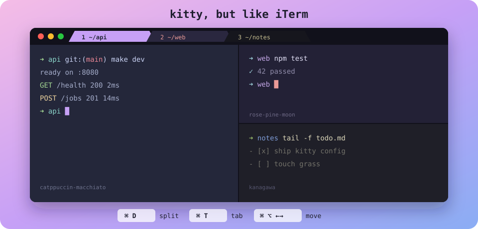
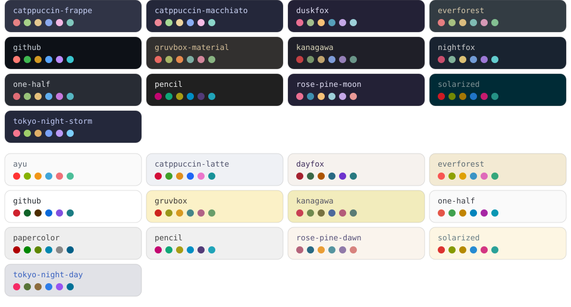

<div align="center">



# kitty, but like iTerm

**The iTerm2 shortcuts you already know, in kitty: fast, GPU-rendered, and configured with plain text.**


</div>

---

I left iTerm2 because it had too many settings. kitty is fast and lives in one text file, but its default
shortcuts are all `ctrl+shift+...`, and I already know iTerm's. This config gives kitty iTerm's keys,
and gives each window its own color theme so you can tell them apart.

## What you get

| | |
|---|---|
| ⌨️ **iTerm2 keymap** | `⌘D` splits, `⌘T` tabs, `⌘1…9` jump, `⌘⌥←→` moves between panes. kitty's defaults are cleared first, so every binding is listed in one file. |
| 🎨 **A different theme per window** | Each new window or tab picks a random theme from 26 curated ones (Catppuccin, Rosé Pine, Kanagawa, Tokyo Night...) and colors its tab to match. The same theme never comes up twice in a row. |
| 🌗 **Follows macOS light/dark** | When you switch the system appearance, every open window instantly picks a new theme from the matching set. kitty sends an event for this, so nothing polls. |
| 🛟 **Asks before closing running programs** | `⌘Q` asks first if something other than the shell is still running in a window. |
| 📋 **iTerm habits** | Copy on select, Option acts as Alt, block cursor, powerline tabs, 10k lines of scrollback, a visual bell instead of a sound. |

## Install

```sh
# 1. back up whatever you have
[ -d ~/.config/kitty ] && mv ~/.config/kitty ~/.config/kitty.backup-$(date +%Y%m%d)

# 2. clone straight into kitty's config dir
git clone https://github.com/atharva-2001/kitty-but-like-iterm ~/.config/kitty
```

```sh
# 3. add to ~/.zshrc: a random theme for every new kitty window
if [[ -n "$KITTY_WINDOW_ID" && "$_KITTY_THEME_WIN" != "$KITTY_WINDOW_ID" ]]; then
  export _KITTY_THEME_WIN="$KITTY_WINDOW_ID"
  ~/.config/kitty/random-theme.sh
fi
```

4. Quit kitty fully and open it again. `allow_remote_control` and `watcher` only take effect on a fresh start.

> [!TIP]
> **Let your coding agent do it.** Paste this into Claude Code, Codex, Cursor, or any agent that can run a shell:
>
> ```text
> Install the kitty config from https://github.com/atharva-2001/kitty-but-like-iterm.
> Follow AGENT_INSTALL.md in that repo exactly. Back up my existing ~/.config/kitty
> first, never delete anything, and show me what you changed when you're done.
> ```
>
> The steps the agent follows are in [`AGENT_INSTALL.md`](AGENT_INSTALL.md).

## Every command

kitty's defaults are cleared with `clear_all_shortcuts yes`, so **this table is the complete list**.
Anything not listed here does nothing.

> In kitty's terms an iTerm **split** is a *window*, and an iTerm **window** is an *OS window*.

### Tabs

| Keys | Does | kitty action |
|---|---|---|
| <kbd>⌘</kbd> <kbd>T</kbd> | New tab, same directory | `new_tab_with_cwd` |
| <kbd>⌘</kbd> <kbd>W</kbd> | Close tab | `close_tab` |
| <kbd>⌘</kbd> <kbd>⇧</kbd> <kbd>]</kbd> &nbsp;or&nbsp; <kbd>⌘</kbd> <kbd>⇧</kbd> <kbd>→</kbd> | Next tab | `next_tab` |
| <kbd>⌘</kbd> <kbd>⇧</kbd> <kbd>[</kbd> &nbsp;or&nbsp; <kbd>⌘</kbd> <kbd>⇧</kbd> <kbd>←</kbd> | Previous tab | `previous_tab` |
| <kbd>⌘</kbd> <kbd>1</kbd> … <kbd>⌘</kbd> <kbd>9</kbd> | Jump to tab N | `goto_tab N` |

### Splits

| Keys | Does | kitty action |
|---|---|---|
| <kbd>⌘</kbd> <kbd>D</kbd> | Split side by side | `launch --location=vsplit --cwd=current` |
| <kbd>⌘</kbd> <kbd>⇧</kbd> <kbd>D</kbd> | Split top and bottom | `launch --location=hsplit --cwd=current` |
| <kbd>⌘</kbd> <kbd>⇧</kbd> <kbd>W</kbd> | Close this split | `close_window` |
| <kbd>⌘</kbd> <kbd>⌥</kbd> <kbd>←</kbd> <kbd>→</kbd> <kbd>↑</kbd> <kbd>↓</kbd> | Focus the split in that direction | `neighboring_window <dir>` |

### Windows

| Keys | Does | kitty action |
|---|---|---|
| <kbd>⌘</kbd> <kbd>N</kbd> | New window, same directory | `new_os_window_with_cwd` |
| <kbd>⌘</kbd> <kbd>⇧</kbd> <kbd>N</kbd> | New window, home directory | `new_os_window` |
| <kbd>⌘</kbd> <kbd>↩</kbd> | Toggle fullscreen | `toggle_fullscreen` |
| <kbd>⌘</kbd> <kbd>Q</kbd> | Quit (asks if programs are running) | `quit` |

### Text and screen

| Keys | Does | kitty action |
|---|---|---|
| <kbd>⌘</kbd> <kbd>C</kbd> | Copy | `copy_to_clipboard` |
| <kbd>⌘</kbd> <kbd>V</kbd> | Paste | `paste_from_clipboard` |
| <kbd>⌘</kbd> <kbd>⇧</kbd> <kbd>V</kbd> | Paste the current selection | `paste_from_selection` |
| <kbd>⌘</kbd> <kbd>K</kbd> | Clear screen and scrollback, redraw the prompt | `clear_terminal scrollback active` + `^L` |
| <kbd>⌘</kbd> <kbd>F</kbd> | Open scrollback in a pager (press <kbd>/</kbd> to search) | `show_scrollback` |
| <kbd>⌘</kbd> <kbd>+</kbd> &nbsp;or&nbsp; <kbd>⌘</kbd> <kbd>=</kbd> | Bigger font, all windows | `change_font_size all +2.0` |
| <kbd>⌘</kbd> <kbd>-</kbd> | Smaller font | `change_font_size all -2.0` |
| <kbd>⌘</kbd> <kbd>0</kbd> | Reset font size | `change_font_size all 0` |

### Config

| Keys | Does | kitty action |
|---|---|---|
| <kbd>⌘</kbd> <kbd>,</kbd> | **Reload** the config (it does not open it) | `load_config_file` |
| <kbd>⌘</kbd> <kbd>R</kbd> | Nothing. It's left for the shell; <kbd>⌃</kbd> <kbd>L</kbd> still clears | `no_op` |

### Shell commands

| Command | Does |
|---|---|
| `~/.config/kitty/random-theme.sh` | Give the current window a new random theme and tint its tab. Your `.zshrc` runs it automatically. |
| `kitten @ set-colors ~/.config/kitty/themes/dark-kanagawa.conf` | Apply one specific theme to the current window |
| `kitten @ set-colors --reset` | Go back to the base theme |
| `kitten themes` | kitty's built-in theme browser. Save one as `themes/dark-<name>.conf` or `themes/light-<name>.conf` to add it to the random rotation. |
| `kitten @ ls` | List every OS window, tab, and window as JSON |

## The themes



The file name prefix decides which set a theme belongs to: `dark-*.conf` themes are used in Dark Mode and
`light-*.conf` themes in Light Mode. To add a theme, drop a file in. To remove one, delete it.

## How it fits together

```text
kitty.conf ─┬─ include      iterm2-keys.conf     every shortcut, kitty defaults cleared
            ├─ geninclude   pick-theme.sh        base theme matching macOS appearance at startup
            ├─ watcher      theme-watcher.py     appearance flips → re-roll every open window
            └─ include      current-theme.conf   fallback colors (written by `kitten themes`)

~/.zshrc ──── random-theme.sh                    new window → random theme + matching tab tint
```

| File | Role |
|---|---|
| [`kitty.conf`](kitty.conf) | General settings that make kitty behave like iTerm, plus the wiring above |
| [`iterm2-keys.conf`](iterm2-keys.conf) | The complete keymap, with each binding's kitty default noted above it |
| [`pick-theme.sh`](pick-theme.sh) | Prints `include theme-light.conf` or `theme-dark.conf` |
| [`random-theme.sh`](random-theme.sh) | Applies a random theme from the matching set to the current window |
| [`theme-watcher.py`](theme-watcher.py) | kitty watcher; `on_color_scheme_preference_change` re-rolls each window |
| [`themes/`](themes) | The 26 themes in the random rotation |

## Good to know

> [!WARNING]
> `allow_remote_control yes` lets **any program running inside kitty** control kitty: change colors, open
> windows, send text. The theme scripts need this. If that bothers you, change it to
> `allow_remote_control password` and set a `remote_control_password` (see the
> [kitty docs](https://sw.kovidgoyal.net/kitty/remote-control/#confval-remote_control_password)).

- **Undo one shortcut:** delete its `map` line. **Get all of kitty's defaults back:** comment out
  `clear_all_shortcuts yes` in `iterm2-keys.conf`.
- **Turn off random themes:** remove the `.zshrc` block and the `watcher` line.
- **Inside vim or a TUI** the app may draw its own background, so the theme only shows around it.
- **Want to flip every open window to light or dark on demand,** even from an AI agent's shell that has no
  terminal attached? See the companion repo
  [**flipping-kitty-themes**](https://github.com/atharva-2001/flipping-kitty-themes).

## Credits

The themes come from [kovidgoyal/kitty-themes](https://github.com/kovidgoyal/kitty-themes). Each file
keeps the author and license from its own header. Everything else is [MIT](LICENSE).
